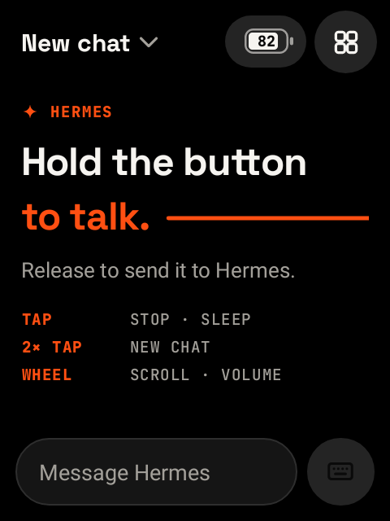
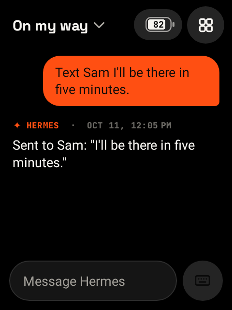
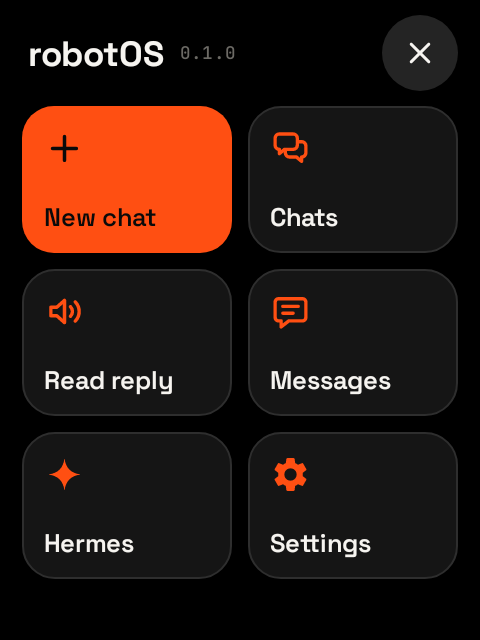
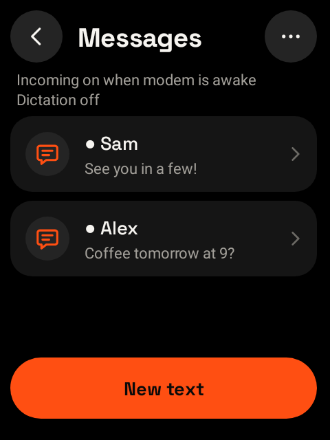
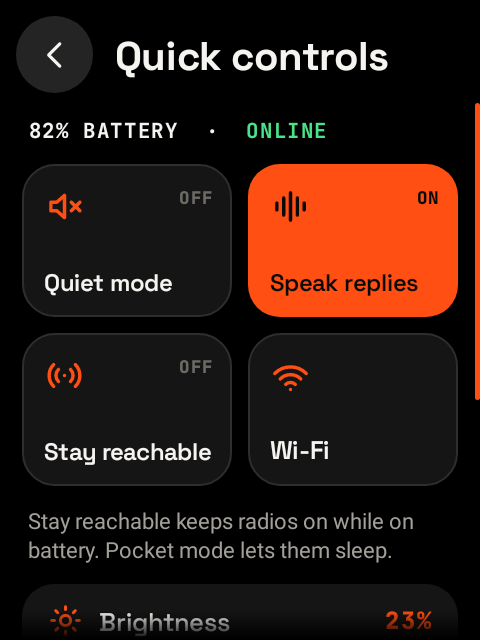

# robotOS: a push-to-talk remote for Hermes on the Rabbit R1

Turns a Rabbit R1 into a push-to-talk remote for your [Hermes Agent](https://github.com/NousResearch/hermes-agent).
Hermes is the agent; the R1 listens, speaks, and acts only when Hermes asks. Hold the side button and
talk; on release, it either sends what you said or types it into the text field:

- **Keyboard closed:** your words go to Hermes. They're transcribed as you speak
  (`gpt-live-transcribe`), sent when you let go, and Hermes's reply is read aloud (`gpt-4o-mini-tts`)
  and shown on screen.
- **Keyboard open:** dictation. Your words appear in the text field as you speak, dimmed until you let
  go, and nothing is sent, so you can edit first. A tap of the button sends it to Hermes.

Hermes acts on the R1 through its `robotos` MCP tools: "text Sam I'm running late" is Hermes texting
from the R1's SIM. When enabled, texts from your own number to the R1 go to Hermes, which texts back.
Separate permissions allow announcements, Home notices, volume changes, saved recipients and opening robotOS apps.
Plugged in, configured radios stay available. OpenAI is used only for speech. See
[docs/HERMES.md](docs/HERMES.md).

The default installation includes a **shared workspace** with written notes, voice recordings and a Prompt Builder on
the R1 and in a self-hosted web console. Combine several notes, add more while editing, preview the
request and save it for later. On the R1, **Run in new chat** opens a fresh chat with the prompt
attached and waits for **Send**. Tap the attachment to edit it in Prompt Builder. The browser
edits and saves prompts; replies and task controls live in Chats. Enrolled R1s share saved prompts
and completed chat replies. Hermes owns execution, conversation history and scheduled jobs.
The console also manages device enrollment, settings and permissioned recovery
commands. See [docs/HUB.md](docs/HUB.md) for setup, synchronization and lost-device limits.
For native services, Docker Compose, k3s, or Hermes and robotOS on separate machines, see
[deployment architectures](docs/DEPLOYMENT.md). The hub owns shared state; the MCP adapter runs
alongside Hermes and connects to that hub.

## Screenshots

The app at the R1's 480×640 screen size, rendered with staged demo data.

| Push to talk | Live transcription | Hermes reply |
|:---:|:---:|:---:|
| [](docs/screenshots/home.png) | [](docs/screenshots/listening.png) | [](docs/screenshots/conversation.png) |
| **Menu** | **Messages** | **Quick controls** |
| [](docs/screenshots/menu.png) | [](docs/screenshots/messages.png) | [](docs/screenshots/quick-controls.png) |

[All screenshots and capture instructions](docs/screenshots/README.md)

robotOS was previously called R1 PTT. Its repository is
[windoze95/robotOS](https://github.com/windoze95/robotOS). The Android package (`dev.r1ptt`),
Magisk module ID (`r1ptt_system`), and existing configuration and build filenames retain their
compatibility names.

> **Status: running on a real R1** (LineageOS 21 on Rabbit's September 2026 kernel). The side button,
> live dictation (final text ~0.4 s after release), push-to-talk and typed turns to Hermes, Hermes
> texting through the R1, and texting Hermes are verified on the device. Standby battery drain hasn't
> been measured ([docs/BATTERY.md](docs/BATTERY.md)).
>
> The current reliability changes add offline-tested transport/capture limits, interruption isolation and
> encrypted-save recovery. Its current-build hardware acceptance is pending; the observations above
> describe the earlier device-tested implementation. See [docs/RELIABILITY.md](docs/RELIABILITY.md).
>
> The daily-driver redesign adds saved chats, contextual wheel navigation, quick controls and
> recoverable Hermes task controls. Local automated coverage is in place; its physical UI,
> acoustic, carrier and overnight battery acceptance remain pending. See
> [docs/DAILY_DRIVER.md](docs/DAILY_DRIVER.md).
>
> Shared workspace and device management have automated persistence, conflict and permission tests.
> One R1 has also passed a reversible lost-device test: offline wake stayed restricted, reconnect
> applied the pending policy, and owner restoration required a fresh connection. Two-device handoff,
> Android secure lock, location, erasure and overnight battery acceptance remain pending. See
> [docs/HUB.md](docs/HUB.md#validation-boundary) for the exact evidence.

## What "firmware" means here

The R1 is an Android 13 phone underneath (MediaTek MT6765). The firmware is four layers:

| Layer | What |
|---|---|
| Kernel + vendor | Rabbit's own, kept from the R1's last OTA (the side button only works with Rabbit's kernel). |
| System | LineageOS 21 (Android 14) GSI, with Rabbit's apps removed and the bloat disabled. |
| Root + tweaks | Magisk, plus the `r1ptt-system` module: button and wheel remaps, Rabbit's USB keyboard/mouse mode off, no scanning/location/Bluetooth, faster Doze. |
| App | robotOS (`dev.r1ptt`): the launcher, push-to-talk service, speech, chat and power policy. |

## Using it

| Button | Keyboard closed | Keyboard open |
|---|---|---|
| **Hold** | Talk; release to send. The reply streams and is spoken. | Dictate; release to insert at the cursor. |
| **Tap** | Screen off. When speaking, stop. (A tap on a dark screen just wakes it.) | Send the typed text. |
| **Double-tap** | New conversation. | — |
| **Scroll wheel** | Scroll the visible page; volume during speech or with its slider selected. | Scroll the visible page; volume during speech or with its slider selected. |

While you hold the button, the screen is orange and shows your words as they're heard. Until
they're sent, tap it to put them in the text field instead, so you can edit them and tap the
button to send. Or swipe it away to cancel: the microphone closes and nothing is sent.

Tap the text field to bring up the keyboard. The chat title opens saved **Chats**, the battery
readout opens **Quick controls**, and the menu opens **Messages**, **Hermes** and **Settings**.
While an approval review is open, button gestures cannot approve it or replace the pending task.

**Menu → Messages** opens the one-to-one SMS handler for texts you write yourself: drafts,
**Review text** and **Send SMS**, incoming texts, and Android's real send and delivery status. The
R1 never decides to send a text on its own; with Hermes, Hermes does (above). No SMS permission is
requested merely by opening Messages; Options can request Android's default SMS role. MMS is
explicitly unsupported; incoming MMS notices are retained locally and shown as warnings. Message
details exposes native failure codes without retrying a failed or uncertain attempt.
MMS, RCS, old inbox import, and live carrier acceptance are not included. See [docs/MESSAGES.md](docs/MESSAGES.md).

**Hermes** shows the paired workspace host, **Host & devices**, **Chats**, local device
permissions and the shared daily SMS count. The host manages models and credentials. **Stop speech**
stops audio; **Chat activity** handles task cancellation and the exact pending approval. Unpaired legacy
connections retain their direct task controls. See [docs/HERMES.md](docs/HERMES.md).

**Workspace → Prompt Builder** holds saved prompts and drafts built from notes and recordings.
**Run in new chat** attaches the prompt without sending it. The composer shows a **Prompt Builder**
card; tap it to edit the source, then **Save and return to chat**. Tap **Send** when ready.
**Workspace settings** pairs each R1 separately and exposes local management permissions. Once paired, new PTT and
owner-SMS conversations use the host's durable run API; shared chats appear in **Chats**. Existing
local conversations remain saved. **Synced** means the host acknowledged the content;
**Saved on this R1** means another device may not have it yet. Paired devices verify recovery
status on boot, wake, foreground and reconnect. Within 15 minutes of a confirmed check, a wake opens
at once and is confirmed in the background. A lost reply takes the screen back, and so does no
answer within 20 seconds of a usable network (at most 30 seconds after the wake). Otherwise the device checks before showing saved content or accepting actions, and an
unreachable host keeps it restricted until verification succeeds.

## Battery

Idle time is where a 1000 mAh battery goes.

- **The cellular modem is off by default** (airplane mode with Wi-Fi left on). With **Use cellular
  data (SIM)** enabled, it wakes with the device and returns to airplane mode at the normal idle cut.
- **Wi-Fi switches off** after 3 minutes with the screen dark. The next button press turns it back
  on, and it reconnects while you're still talking.
- **Plugged in, configured radios stay available.** On external power the idle cut is skipped.
  **Stay reachable** extends that policy to battery operation; switching it off restores the saved
  pocket-mode delay. Reachability still depends on coverage, connectivity and Tailscale.
- **No network polling while pocket-mode radios are off:**
  - no polling, scanning, location or Bluetooth;
  - Rabbit's apps are removed;
  - Doze starts within seconds.
  - Optional incoming SMS use Android broadcasts while the modem is reachable. Messages does not
    keep it awake; carrier-queued delivery after wake is not guaranteed.
- **The screen is held on while listening.** It can time out during remote work, playback or an
  approval wait; the default timeout is 15 s at low brightness.
- **Paired devices sync while connected.** About every 30 seconds an R1 checks in and downloads
  only what changed on the host. Optional recovery check-ins briefly wake configured
  radios and may obtain a permitted location fix. They are off by default and need separate battery
  measurement. Voice streams only while you hold the button.

[docs/BATTERY.md](docs/BATTERY.md) covers the design and how to measure the idle drain.
[docs/ACCEPTANCE.md](docs/ACCEPTANCE.md) defines current-build latency, interruption, reconnect,
service-restart and overnight standby checks. Hardware and acoustic acceptance remain pending;
the read-only capture and offline analyzer include synthetic fixtures, not hardware results.

## Getting started

1. **Check speech from your Mac first:**
   ```sh
   cp tools/r1ptt.example.json tools/r1ptt.json   # set openaiKey
   tools/smoke-test.sh --play
   ```
   The example config contains local speech and device preferences only; pairing supplies the
   workspace identity. Do not add the host's Hermes API key or owner password.
2. **Follow [docs/INSTALL.md](docs/INSTALL.md):** unlock (Rabbit's developer mode) → stock baseline →
   LineageOS GSI → Magisk → `tools/provision.sh --config tools/r1ptt.json`.
3. **Install the complete Docker Compose stack** on an always-available host. From this repository:
   ```sh
   python3 deploy/configure.py --directory deploy/hub/private
   cp deploy/hub/.env.example deploy/hub/.env
   ```
   Set the exact HTTPS `ROBOTOS_PUBLIC_ORIGIN` and `HERMES_API_URL` in `.env`. Keep existing `.env`
   and secret files on upgrades. Then pull the published images and configure Hermes's provider:
   ```sh
   cd deploy/hub
   docker compose -f compose.yaml -f compose.hermes.yaml pull
   docker compose -f compose.yaml -f compose.hermes.yaml run --rm -it --no-deps hermes setup
   docker compose -f compose.yaml -f compose.hermes.yaml up -d --no-build
   ```
   The default images use the moving `main` development tag; pin both to the same immutable
   `sha-<full-commit>` tag for production. Speech transcription needs its own configured provider.
4. **Expose HTTPS and enroll each R1.** Follow the complete
   [Docker quickstart](docs/DEPLOYMENT.md#primary-setup-docker-compose-with-robotos-and-hermes)
   for Tailscale or Caddy routes, readiness checks and optional host transcription. Keep existing
   proxy routes intact. Sign in to the hub console with `private/owner-password`, create one
   enrollment code per R1, and enter the hub URL and code in **Workspace settings**. Host
   credentials stay on the host; device permissions remain local.

Docker Compose is the primary community setup. Native macOS/Linux services, k3s and separate
Hermes/robotOS machines remain supported in [docs/DEPLOYMENT.md](docs/DEPLOYMENT.md). If Hermes
is already installed natively, `tools/hub-setup.sh --public-origin https://your-host` installs and
checks the complete native integration. The old direct-to-Hermes setup is an explicit
[legacy option](docs/HERMES_DIRECT.md); it does not provide the shared workspace or its recovery gate.

For self-hosted speech instead of OpenAI, see [server/speaches.md](server/speaches.md).

## Repo layout

```
app/                    native Android app (Kotlin, OkHttp + coroutines; Robolectric tests)
magisk/r1ptt-system/    Magisk module: keylayout + boot-time power settings
tools/                  build, smoke-test, flash, provision, battery-report scripts
server/                 shared workspace service and web console, Hermes MCP adapter and setup
docs/                   install guide, Hermes remote, messages, battery notes
```

Build: `tools/build.sh` (JDK 17+ and the Android SDK; writes `out/r1ptt.apk` and
`out/r1ptt-system.zip`).
Tests: `./gradlew :app:testDebugUnitTest` and
`PYTHONPATH=server python3 -m unittest discover -s server/robotos_hub/tests`, with MCP and installer
suites under `server/robotos_mcp/tests` and `server/hermes/tests`. Browser model tests run with
`node --test server/robotos_hub/web/tests/*.test.mjs`.

App updates: **Settings → App updates** checks for signed APK releases when requested. The
release workflow is disabled until signing continuity and owner-controlled bootstrap are set up.
See [docs/UPDATES.md](docs/UPDATES.md) for release tags, secure signing setup, the first device
installation, Android confirmation and recovery. It updates the app only; hardware acceptance
of the updater remains pending.

## License

MIT; see [LICENSE](LICENSE). Parts are adapted from ClawPTT (also MIT); [NOTICE](NOTICE) has the
credits. Not affiliated with Rabbit Inc. Flashing can brick a device, and unlocking voids the R1's
warranty.
