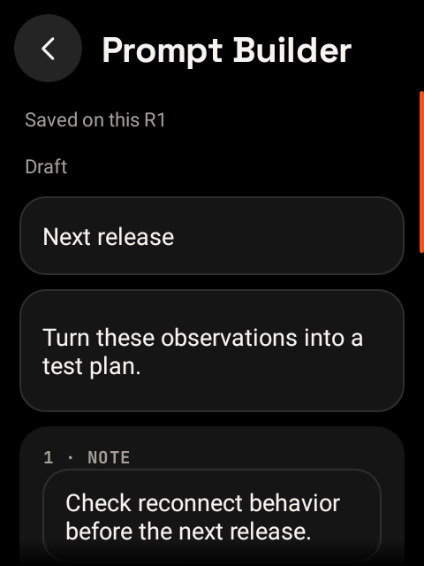
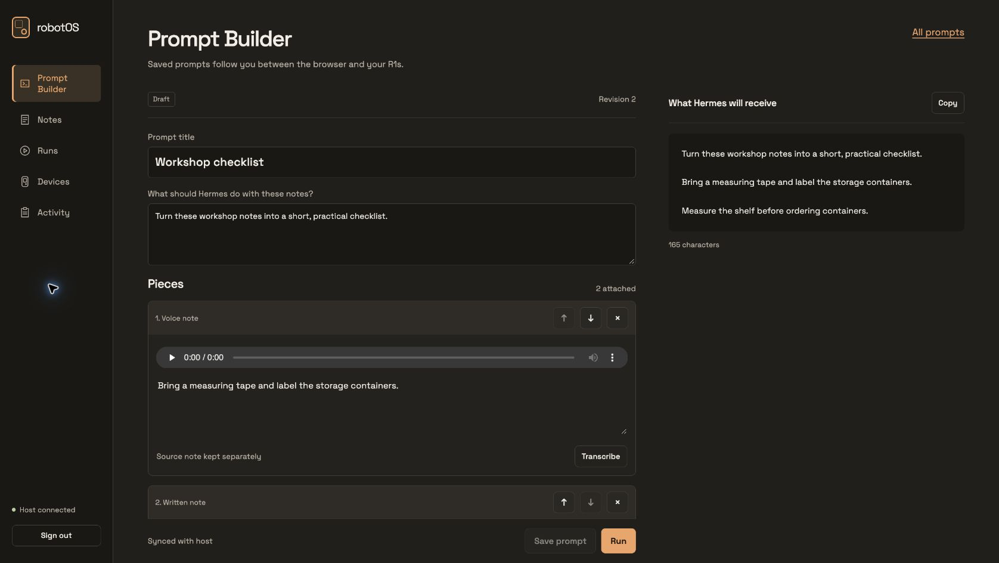

# Shared workspace and device management

The robotOS host service stores notes, recordings, prompt revisions and device policy. It keeps
submission receipts and confirmed replies for shared R1 chats. Hermes owns agent execution,
session history and scheduled jobs. R1 devices and the browser use the same hub API, and Hermes
accesses the workspace through the robotOS MCP adapter. The service
runs independently of Hermes, so saving and syncing do not require an agent turn.

The host database is authoritative. Each R1 keeps a local cache and pending captures. A local save
is not a cross-device save until the service acknowledges it. Audio is acknowledged only after
the host durably stores and verifies the upload. Pending notes and recordings survive connection
loss, but a paired R1 cannot open or edit saved content until its recovery check succeeds.
“Saved on this R1” describes durability, not availability on another device or permission to use
cached content while recovery status is unknown.

| R1 Prompt Builder | Web console |
|---|---|
| [](screenshots/workspace-builder.png) | [](screenshots/workspace-console.jpg) |

These examples use staged test data; see [screenshot evidence](screenshots/README.md).

## Install and enroll

The primary community installation is the complete **Docker Compose stack**: robotOS hub plus
Hermes, using published images and separate persistent volumes. Follow the
[Docker quickstart](DEPLOYMENT.md#primary-setup-docker-compose-with-robotos-and-hermes) to initialize
private credentials, configure Hermes's model/provider, start services and expose HTTPS.
Native services, split hosts and k3s are supported alternatives in the same guide.

Check the hub's `/api/v1/ready` over its final HTTPS origin, then open the console. Read the saved
owner password locally (`deploy/hub/private/owner-password` for Compose), sign in, open Devices,
and create an enrollment code. Enter the hub URL and code under **Workspace settings** on the R1.
Codes are short-lived and single-use: enroll each R1 separately and give it a clear name so device
actions have an unambiguous destination. Never import the owner password or Hermes API key into
an R1. Existing live-dictation and spoken-reply settings remain local.

Pairing clears the R1's legacy Hermes API credential and rotates its private native device API
token without enabling permissions. Paired PTT and owner-SMS conversations use the hub; device
actions are queued for an explicit enrolled device and still pass native permission, receipt
and SMS-quota checks. The MCP receives only a scoped credential; it cannot enroll devices,
change lost policy or erase devices. Validate enrollment and saved-state handoff on both R1s
before relying on cross-device continuity.

## Native installation alternative

Requirements: Python 3.9+, the robotOS source, and Hermes already installed with its model/provider
configured. The hub uses the Python standard library. The native default supports macOS launchd
and Linux systemd user services:

```sh
tools/hub-setup.sh --public-origin https://YOUR-HOST.YOUR-TAILNET.ts.net:9443
```

This installs the persistent hub, configures the authenticated loopback Hermes API and scoped MCP
adapter, starts both services and checks them. `--register-hermes` remains a compatibility alias;
it is no longer a second required installation step. For a remote Hermes gateway, explicitly use
`--hub-only`; on that separate Hermes machine use `--mcp-only` with the hub's scoped token.
See [DEPLOYMENT.md](DEPLOYMENT.md#native-hosts-and-split-hosts) for the exact commands.
`--no-start` prepares files without starting services.

The installer writes private configuration and code under `~/Library/Application Support/robotOS/hub`
on macOS, or `~/.local/share/robotos-hub-service` on Linux. It prints paths, never credentials. Read
`owner-password.txt` locally to sign in. Keep `hub.json` at 0600 and its parent directory at 0700.
Reinstallation retains secrets, workspace data, media, model/provider and unrelated MCP settings.

Configuration contains `bind`, `port`, `data_dir`, `public_origin`, `owner_password`, `owner_token`,
`mcp_token`, `hermes_url`, `hermes_token`, `speech_url`, `speech_token`, and `speech_model`.
An existing Hermes `API_SERVER_KEY` is retained; a fresh native installation generates one when
needed. The key stays on the host. `OPENAI_API_KEY`, when present in Hermes's protected `.env`,
can initialize host transcription; otherwise configure a compatible speech endpoint and key
separately. Recorded audio can be saved without automatic transcription.

The hub binds loopback at port 8787. The installer does not create or replace HTTPS routes.
Inspect your proxy's configuration first. With an already signed-in Tailscale node, check
`tailscale serve status`; if 9443 is unused, expose the hub with:

```sh
tailscale serve --bg --https=9443 http://127.0.0.1:8787
```

For an existing private macOS Tailscale node installed by the older robotOS setup, use its socket
for both inspection and configuration:

```sh
tailscale --socket="$HOME/Library/Application Support/robotOS/tailscale/tailscaled.sock" serve status
tailscale --socket="$HOME/Library/Application Support/robotOS/tailscale/tailscaled.sock" \
  serve --bg --https=9443 http://127.0.0.1:8787
```

Choose another unused HTTPS port if 9443 is occupied. Set `public_origin` to the exact resulting
browser origin, including its nondefault port. Preserve existing Hermes and other routes; paired
R1s only need the hub's route. Do not use Tailscale Funnel. Device pairing requires HTTPS except
for local development. Check the final HTTPS `/api/v1/ready`, then enroll devices as above.

Use an always-available host. macOS LaunchAgents run in the logged-in user's session; they do not
start before login. Linux installs a systemd **user** service. To keep it active after logout and
start it at boot, an administrator can enable lingering for the service user, for example
`sudo loginctl enable-linger "$USER"`, then verify it with `loginctl show-user "$USER" -p Linger`.
The host must remain awake and its network/proxy available. Native setup does not change sleep,
login or administrator policies. If the hub is unavailable, a paired R1 stays restricted until
it can verify its recovery status.

During an active shared conversation the R1 checks for device commands while awaiting its reply.
The MCP adapter briefly reads the same command's receipt, without submitting it again. It waits
up to five seconds by default (`ROBOTOS_HUB_RECEIPT_WAIT_SECONDS`, 0–10 seconds); commands that
have not completed remain queued or received and can be checked by their original ID.

For a foreground development service, use a private configuration file and:

```sh
PYTHONPATH=server python3 -m robotos_hub --config /absolute/path/to/hub.json
```

The console is bundled static HTML, CSS and JavaScript. It requires no external font/CDN service
or JavaScript build chain. Browser sessions use HttpOnly cookies and CSRF protection; bearer
credentials are not placed in browser local storage or URLs.

## Prompt Builder

Capture written notes or recordings, select several, and add them to a new or existing prompt.
From an open builder, add an existing note, write another note or record another clip. Arrange
the blocks, correct transcripts and preview the exact request. Source notes remain reusable;
removing a block does not delete its note. Recording uploads and transcription failures retain
the original audio for recovery.

Saving changed content creates a revision; saving unchanged content keeps the current revision.
Only one client holds the edit lease for a prompt. Continuing on a
second client fences the old editor; stale saves are rejected and the client retains its unsaved
work. Independent note captures can coexist. Captures saved before a connection fails may sync
later; once the recovery gate takes over, it blocks paired-device use until verification succeeds.
Shared prompt edits and chat submission require the host.

On the R1, open a saved prompt and choose **Run in new chat**. robotOS opens a fresh chat with a
**Prompt Builder** card in the composer and waits for **Send**. Tapping the card opens that prompt
in the builder, where **Save and return to chat** updates the attachment. The attached composer
does not accept typing or dictation. Once sent, its exact text and source revision stay with the
chat message; later prompt edits do not rewrite it.

The browser console edits, previews and saves prompts. Prompt Builder does not show replies or
execution status. Replies appear in Chats, with pending work, approval and cancellation controls
in **Chat activity**. Older Prompt Builder submissions remain accessible under **Chats → Earlier
chats**. Save for later means returning to the saved prompt; Hermes manages scheduled jobs.

Sending reserves an immutable message snapshot before dispatch. Duplicate taps keep the same
submission identity. A dropped connection or unknown submission never authorizes a replacement
request. Stop requests remain pending until Hermes confirms their outcome. Approvals apply to
the exact request and approval ID.

The service permits only one active run per prompt/session, including across revisions. An
uncertain submission can be checked explicitly using its original identity only while Hermes's
advertised durable deduplication window remains valid. Otherwise it stays unresolved for inspection
on the original host. The service does not infer failure from a timeout.

Paired PTT uses shared conversations with immutable turn snapshots. Completed replies sync into
Chats on both R1s, and the host retains conversation context. Unsent chat drafts, attachments and
scroll positions remain local; their saved source prompts sync between devices. The last shared
prompt is available through Continue; changing devices does not silently replace an unsent draft.
Existing conversations from before pairing remain local.

## Device management and recovery

The console shows device-reported state with observation times. Settings distinguish desired
values from acknowledged applied values. Device commands have stable IDs, a specific destination,
an expiration and a durable receipt. Queued and Received are not Applied. An unknown result is
preserved for reconciliation, never blindly retried as a new operation.

Each R1 has distinct workspace and recovery credentials. Marking it lost or revoked blocks shared
workspace access on the host immediately. Its restricted recovery identity can still check in,
receive its own recovery commands and acknowledge them. A sleeping offline device cannot receive
the new instruction yet. On a wake more than 15 minutes after its last confirmed check, the
verification gate hides cached content and blocks ordinary actions even before that pending policy
can arrive. Within that window the R1 opens at once and takes the screen back as soon as the
policy arrives, or after 10 seconds without an answer. Physical erasure still requires the device
to receive and execute a permitted command. The shared workspace and other R1s are not erased
when local data is cleared.
The lost policy is durable and has no expiration. On boot, waking, returning to robotOS or reconnecting,
the R1 checks that policy before revealing cached content or resuming ordinary device actions. Once received,
it saves the restriction before processing recovery commands. A blocked device remains blocked
across app restarts and offline periods until it receives a newer policy restoring access. The
console distinguishes the owner's requested policy from the exact policy acknowledged by the R1;
a stale check-in cannot confirm a newer lost request. This is separate from command expirations.

Marking lost or revoked cancels queued agent actions (including MCP recovery requests), updates
and reboots. Only owner-issued recovery actions remain available; legacy queued commands without
issuer evidence are cancelled conservatively. Already-received
actions become unknown because they may have executed; a later final receipt is retained.
New ordinary command admissions are denied, including receipt handoffs racing with a lost request.
Ordinary settings changes are also disabled until the owner restores access.
Owner recovery commands such as ringing, return information and locally permitted locking remain
available after the R1 confirms that it has applied the policy. Local permissions still apply.
This prevents new agent requests; work already admitted to Hermes may finish and must be checked
with the original prompt. Revocation does not undo an external action that has already happened.
Clearing local workspace also revokes its workspace credential immediately and requires a new
enrollment code to restore shared access. Its recovery credential remains available.

Management capabilities depend on on-device permission and Android support. Ringing, return
information, location reporting, secure locking, clearing local workspace, app updates, reboot
and factory reset must advertise their actual availability. Unsupported operations are rejected.
Location requires a working provider, precise location permission and Android's “Allow all the
time” background permission, granted on the R1. Enable system location if provisioning disabled
it. A fix includes its timestamp and
accuracy; a missing fix is not the device's current position. Secure lock requires a PIN/password
and active device-admin support. Factory reset requires supported device-owner enrollment and
separate local authorization. Provisioning preserves the existing lock screen and device-admin
state; it does not create a credential or grant admin access. Older provisioning disabled the
keyguard, so configure and verify a secure credential locally before relying on remote locking.

Protection adapts to the security features actually enabled on the R1. Without a secure Android
credential, robotOS restricts its own screens and action entry points; this does not lock Android
or prevent access through other apps, debugging or a modified operating system. With a secure
credential, active device admin and locally enabled management, lost mode can also request an
Android lock. Capability checks refresh when robotOS resumes and reports its state, so enabling
those protections locally does not require re-enrollment. No local permission is silently granted.
The console reports app restrictions, secure credential availability, remote-lock support and
device-reported lock application separately, together with the last connection time. A lock
receipt is evidence that Android accepted a lock action, not proof that the device remains locked.

Recovery check-ins are opt-in and coordinate with the existing radio policy. They trade standby
battery life for opportunities to receive commands. A server cannot reach an R1 while all of its
radios are off. An alarm or location request sent to an offline device remains queued until a
connection is available, and may expire first. The rooted/unlocked platform does not establish
tamper-resistant theft protection.
Foreground, wake and reconnect checks protect normal use without enabling periodic background
radio wakeups: with the screen off, a check never switches the radios back on after the idle cut.

For 15 minutes after a confirmed check, a wake or a return to robotOS opens at once and is
confirmed in the background. A lost or revoked reply takes the screen back immediately; no
confirmation within 10 seconds takes it back and ends the grace, so the next wake checks first.
That window is the deliberate trade: someone who wakes the R1 inside it can see cached content
until the check fails or reports it lost. The grace lives in memory only, so a reboot or app
restart always checks before showing anything.

Outside the grace, and whenever the screen is taken back, the R1 shows the robotOS logo glowing on
black while it checks. A check that passes fades straight to the screen; the recovery screen
fades in only if the check takes longer than 3.5 seconds. It stays until a successful check
verifies access, retrying on its own while it is showing (after 1 second, backing off to every
30 seconds) and saying whether the R1 has no internet connection or the host did not answer.
The cache remains saved on disk, and network setup and recovery checks remain available. Older robotOS clients must be updated to use this strict
verification gate, acknowledge versioned recovery policy and report the new security posture.

Update commands must follow the existing signed-release verifier and Android installer policy.
The command specifies the official release version code; arbitrary APK URLs are not accepted.
An installer handoff is not proof of installation and may require confirmation on the R1. Commands
stay unconfirmed until the installed version is reported. Full-device reset, reboot and installation
need physical acceptance; automated tests do not establish those results.

## Backups and recovery

Back up the live database using SQLite's online backup operation, together with every referenced
immutable recording. The supplied tool verifies database integrity and every recording hash:

```sh
python3 tools/hub-backup.py --data /private/hub/data --output /private/backups/robotos-2026-10-11
```

The destination must be new and outside the live data directory. Backups contain personal notes,
audio and device identity hashes; keep them private. Save `hub.json` separately with equivalent
protection. To restore, stop the host service, restore into a new 0700 data directory, verify its
contents, point `data_dir` there and restart. Retain the previous directory until verification.
Reconcile any unknown runs before submitting again. A restored older snapshot cannot prove that
external work or SMS did not happen after the snapshot was made.

## Validation boundary

The automated suites exercise host concurrency, permissions, persistence, device command receipts,
Android cache and capture recovery, and browser state handling. Container and disposable k3s
smokes verify the deployment manifests; they do not establish production-cluster availability.

On 2026-10-11, one R1 running the signed local `0.4.0-recovery-dev` acceptance build passed a
reversible lost-device test. It was put offline and asleep, then marked lost in the hub. Waking
offline showed the recovery gate and blocked ordinary input. Reconnecting acknowledged the
pending lost policy in 2.21 seconds. The restriction survived an app process restart. An owner
restore requested while offline did not expose content; reconnecting acknowledged the newer
policy and restored Home. Original policy and radio settings were restored. No PIN or device
admin was enabled, so this tested robotOS's app restriction, not Android secure locking.

The subsequent `0.4.0-recovery-dev2` build was installed with the same signing identity. Its paired
Home, Hermes navigation, Host & devices, Connections and Workspace runs were checked on the R1;
a completed live prompt result remained available. These are unpublished acceptance builds.

Still required: a second physical R1 for save/handoff and concurrent editing, full power-cycle
and acoustic/carrier acceptance, permitted location reporting, Android PIN/admin secure locking,
Android update-installer completion, and matched overnight recovery-check-in battery measurements.
Use disposable device data for erasure tests and retain a verified recovery image before testing
factory reset. Neither those destructive actions nor secure locking were physically tested here.

For each deployment, record the app version, hub image/commit, device names, timestamps and actual
outcomes for these checks. A saved receipt or simulated result alone does not establish a physical
action:

| Check | Required observation |
|---|---|
| New paired device | Its own enrollment succeeds; host API/owner keys are absent from device setup; local permissions retain their prior values. |
| Two-device handoff | Save a note, recording and prompt on A; wait for Synced; continue on B with the same content/revision. Completed chat replies also appear in Chats. |
| Prompt attachment | On an R1, Run in new chat opens the Prompt Builder card without sending. Tap to edit, save back to the same chat, then Send; the reply appears in that chat. |
| Concurrent editing | Continue editing on B while A has an old editor open; A's stale save is rejected and its unsaved work remains recoverable. |
| Offline lost/restore | Mark an asleep offline R1 lost; wake stays restricted; reconnect acknowledges the exact policy; offline restoration waits for fresh verification. |
| Adaptive secure lock | With a locally configured PIN and approved admin/management permissions, repeat the reversible lost test and inspect Android's actual lock screen and the console's separate acknowledgment. |
| Availability | Verify service restart, host reboot/login requirements and device reconnect using existing credentials and data, without resubmitting an uncertain run. |
| Standby | Measure matched unplugged nights with recovery check-ins off and on; retain radio/settings evidence and actual battery measurements. |

The wire contract is in [HUB_PROTOCOL.md](../server/HUB_PROTOCOL.md).
